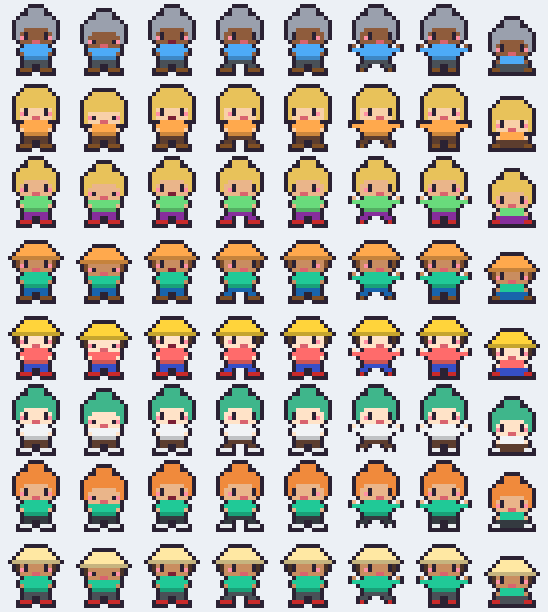

# 카톡 도트 친구들 (KakaoPets)

카카오톡 채팅방 사람들이 도트 캐릭터가 되어 바탕화면 아래를 뛰어다니고,
누가 채팅을 치면 그 캐릭터 머리 위에 말풍선으로 내용이 뜹니다.

## 다운로드

**[KakaoPets-win64.zip 받기](https://github.com/Chason93/kakao-pets/releases/latest/download/KakaoPets-win64.zip)** (약 110MB, 설치 없이 실행)

## 필요한 것

- Windows 10(2004 이상) 또는 Windows 11
- PC 카카오톡 (기본 테마: 남의 말풍선 흰색 / 내 말풍선 노란색)

## 실행

1. 압축을 아무 폴더에나 풉니다 (바탕화면, 문서 등. Program Files 는 피해 주세요)
2. PC 카카오톡에서 띄우고 싶은 채팅방 창을 엽니다
3. `KakaoPets.exe` 실행 → 채팅방 목록에서 방을 고르고 **연결**

처음 실행할 때 Windows 가 "PC 보호" 창을 띄우면 **추가 정보 → 실행** 을 누르세요 (서명이 없는 프로그램이라 뜨는 경고입니다).

## 쓰는 법

- 채팅을 친 사람만 캐릭터로 나타나고, 10분 동안 조용하면 퇴장합니다
- 캐릭터를 마우스로 잡아 던질 수 있고, 클릭하면 마지막으로 한 말을 다시 보여줍니다
- 캐릭터 우클릭 → **모습 바꾸기…** 로 사람마다 머리 모양·색을 바꾸거나 그림 파일로 교체
- 작업 표시줄 오른쪽 아래 트레이 아이콘(`^` 안에 숨어 있을 수 있음) 우클릭:
  채팅방 바꾸기 / 캐릭터 숨기기 / 스크린샷·화면 공유에 보이기 / 종료

## 꼭 지켜야 하는 것

- 카톡 채팅방 창을 닫거나 최소화하면 읽을 수 없습니다 (다른 창 뒤에 가려지는 건 괜찮음)
- 채팅창은 맨 아래로 스크롤해 두세요. 위로 올려 두면 새 메시지가 안 보여서 못 읽습니다
- 채팅창이 너무 작으면 놓치기 쉽습니다. 세로로 넉넉하게 두세요

## 알아둘 점

- 카카오톡은 채팅을 읽는 공식 기능을 제공하지 않아서, 채팅창 화면을 글자 인식(OCR)으로 읽습니다.
  그래서 가끔 글자나 띄어쓰기, 보낸 사람이 틀릴 수 있고, 사진·이모티콘은 말풍선으로 뜨지 않습니다
- 정확한 닉네임 목록을 확인하려고, 카톡과 마우스·키보드를 안 쓰는 틈에 가끔 채팅창 내용을
  복사(Ctrl+A, Ctrl+C)합니다. 그 뒤 채팅창 메시지가 선택된 것처럼 어둡게 보일 수 있는데
  채팅창을 한 번 클릭하면 사라집니다. 원래 클립보드 내용은 되돌려 놓습니다.
  이게 싫으면 `config.json` 에서 `"names_from_copy": false` 로 바꾸세요
- **채팅 내용은 이 PC 안에서만 처리되고 어디로도 전송되지 않습니다**
- 카카오와 관계없는 개인 제작 프로그램입니다

## 설정 / 문제 해결

- 설정은 같은 폴더의 `config.json` (처음 실행하면 생김). 메모장으로 고친 뒤 다시 실행
- 문제가 생기면 같은 폴더의 `kakao_pets.log` 를 확인하세요
- 캐릭터가 안 나오면: 채팅방 창이 열려 있는지, 맨 아래로 스크롤돼 있는지, 그 방에 새 채팅이 올라왔는지 확인

## 포함된 오픈소스

Python, [RapidOCR](https://github.com/RapidAI/RapidOCR) · PP-OCR 모델 (Apache-2.0), [ONNX Runtime](https://github.com/microsoft/onnxruntime) (MIT),
[OpenCV](https://opencv.org) (Apache-2.0), NumPy (BSD), Pillow (MIT-CMU), [pystray](https://github.com/moses-palmer/pystray) (LGPL-3.0),
[windows-capture](https://github.com/NiiightmareXD/windows-capture) (MIT), pywin32 (PSF), [PyInstaller](https://pyinstaller.org) 로 묶었습니다.
